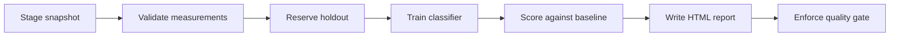

# Airflow pipeline to classify Palmer Penguin species using logistic regression on four body measurements.

This code classifies **Palmer penguin species** from four body measurements
using logistic regression. It includes an offline dataset snapshot, input checks,
a stratified holdout, a baseline comparison, model persistence, an HTML evaluation
report, and a quality gate. Airflow schedules the workflow every Monday at 09:00 UTC;
manual runs are also supported. There are no external services or API keys to configure.

## What changed from the reference

| Area | This implementation |
| --- | --- |
| Dataset | 344 Palmer penguin observations; three species |
| ML task | Supervised classification with logistic regression |
| Preprocessing | Training-only median imputation and standardization |
| Evaluation | Stratified 25% holdout; macro F1, accuracy, per-species scores, confusion matrix |
| Baseline | Most-frequent-species classifier fitted on training labels |
| Task handoff | Small directory-path strings in XCom; shared-volume artifacts |
| Output | Fitted preprocessing/model pipeline, predictions, model card, report, release decision |
| Failure behavior | Validation failures stop training; failed quality gate retains the report |

## Workflow



The model uses `bill_length_mm`, `bill_depth_mm`, `flipper_length_mm`, and
`body_mass_g`. Species is the target. Island, sex, and year are excluded so this
exercise focuses on morphology. Missing measurements stay missing until the
training pipeline learns its medians. The seed is 17; the split is stratified.
No hyperparameter search uses the holdout.

The release gate requires macro F1 of at least **0.90** and a lift of at least
**0.10** over baseline macro F1. A failed gate raises an error and marks the
Airflow task failed; it does not deploy or promote a model anywhere. The report
is deliberately upstream of this task. These thresholds are teaching defaults,
not evidence that this classifier is suitable for field deployment.

## Quick start with Docker Desktop

Use Linux containers, Docker Compose v2.14+, and at least 4 GB of Docker memory
(8 GB is more comfortable). This lab pins Airflow **2.10.5 / Python 3.12** to keep
the Airflow 2 learning workflow reproducible. It is a local teaching environment.
The relevant upstream setup guidance is the
[Airflow 2.10.5 Docker guide](https://airflow.apache.org/docs/apache-airflow/2.10.5/howto/docker-compose/index.html).

Open a terminal **in this folder**. On PowerShell:

```powershell
Copy-Item .env.example .env
New-Item -ItemType Directory -Force artifacts | Out-Null
docker compose build
docker compose up airflow-init
docker compose up -d airflow-webserver airflow-scheduler
docker compose ps
```

On macOS/Linux:

```bash
cp .env.example .env
mkdir -p artifacts
# On Linux, replace AIRFLOW_UID in .env with the output of: id -u
docker compose build
docker compose up airflow-init
docker compose up -d airflow-webserver airflow-scheduler
docker compose ps
```

The init service should exit with code 0. It creates the metadata tables and the
local login from `.env`. The default is **penguin / penguin-lab**. The UI is bound
to [localhost:8080](http://localhost:8080). The database has no published host port.

In the Airflow UI:

1. Find `penguin_species_lab` and unpause it.
2. Trigger a manual run using the play button.
3. Open the run's Graph view and inspect the seven task logs.
4. Open the `stage_snapshot` task's XCom entry to find the run folder name.
5. Open `artifacts/<run-folder>/report.html` on your host. Check `release.json`
   for the gate decision and `predictions.csv` for individual holdout predictions.

The DAG starts paused to avoid an unexpected scheduled run. Catchup is disabled.
The shared artifact folder is necessary: XCom paths must refer to files available
to every task. LocalExecutor provides this here. Moving to distributed workers
would require a shared filesystem or an object-store artifact implementation.

Code and the dataset are baked into the image; **rebuild after editing them**.
For a permission error on Linux, check the artifact folder owner and the UID in
`.env`. Keep the default UID on Windows/macOS. Port 8080 can be changed on the
left side of the Compose port mapping if another service already uses it.

Stop the lab while preserving the metadata and logs:

```bash
docker compose down
```

## Run the same ML workflow without Airflow

Use Python **3.11 or 3.12**. Native Windows can run this CLI; run Airflow itself
in the Linux Docker image. From this folder:

```powershell
py -3.12 -m venv .venv
.venv/Scripts/python -m pip install -r requirements-dev.txt
.venv/Scripts/python -m penguin_lab.cli --run-label first-field-notes
.venv/Scripts/python -m pytest -q
```

On macOS/Linux, use `python3.12 -m venv .venv` and `.venv/bin/python` in the
remaining commands. The CLI prints the absolute report location and returns
exit code 1 on invalid input or a failed gate.

Optional inputs:

```bash
python -m penguin_lab.cli --source /path/to/penguins.csv --artifact-root artifacts --run-label new-survey
```

A custom CSV must contain the same measurement columns and all three species.
Validation checks numeric ranges, infinities, label coverage, sample size,
missingness (at most 10% per measurement), and duplicate measurement/label pairs.
The bundled snapshot is checked against its recorded SHA-256; custom snapshots
get their own fingerprint. This CLI does not automatically rewrite provenance.

Each run label maps to a stable, filesystem-safe hash. Reusing the label reruns
the same folder; use a fresh label when you want to preserve an earlier run.
Airflow uses its unique run ID as that label. Run IDs do not become raw paths.
Writes of JSON, models, and reports use temporary files followed by replacement.

## Inspect and test Airflow

After the containers are running:

```bash
docker compose exec airflow-scheduler airflow dags list-import-errors
docker compose exec airflow-scheduler python tests/check_dag.py
docker compose exec airflow-scheduler airflow dags test penguin_species_lab 2025-01-06
```

`check_dag.py` uses the real Airflow DagBag to check parsing, task IDs, task
dependencies, catchup, concurrency, and the gate's retry setting. `dags test`
runs the full DAG locally in the container; it complements the manual scheduler
run, rather than testing scheduler timing.

The regular pytest suite covers model reload/predictions, disjoint splits,
training-only imputation, reproducibility, invalid snapshots, gate failures,
threshold validation, and safe artifact paths. The reference dataset is bundled,
so tests and task execution need no network after dependency installation.

## Files and outputs

```text
compose.yaml                PostgreSQL, init, webserver, LocalExecutor scheduler
Dockerfile                  Airflow image plus pinned ML libraries
dags/penguin_species.py      Seven-task TaskFlow DAG
penguin_lab/pipeline.py      Validation, split, train, evaluation, quality gate
penguin_lab/report.py        Self-contained HTML evaluation report
penguin_lab/cli.py           Scheduler-free runner using the same functions
dataset/                    CSV snapshot, checksum, source credit
tests/                      ML behavior tests and real Airflow parsing check
artifacts/example/          Example run supplied with this project
VALIDATION.md               Checks actually run in the authoring environment
```

A successful run contains `source.json`, `measurements.csv`, `validated.csv`,
`quality.json`, `train.csv`, `holdout.csv`, `split.json`, `species_model.joblib`,
`model_card.json`, `metrics.json`, `predictions.csv`, `report.html`, and
`release.json`. Only load joblib models you created or trust. Recreate the model
with the provided requirements when changing Python or scikit-learn versions.

The report is a static HTML artifact with no server, CDN, or JavaScript dependency.
It shows holdout metrics, a confusion matrix, per-species scores, misclassified
birds, missingness, provenance, and limits of the experiment. Its observations
describe a fixed historical snapshot; weekly scheduling demonstrates orchestration,
not live collection of new penguin observations.
